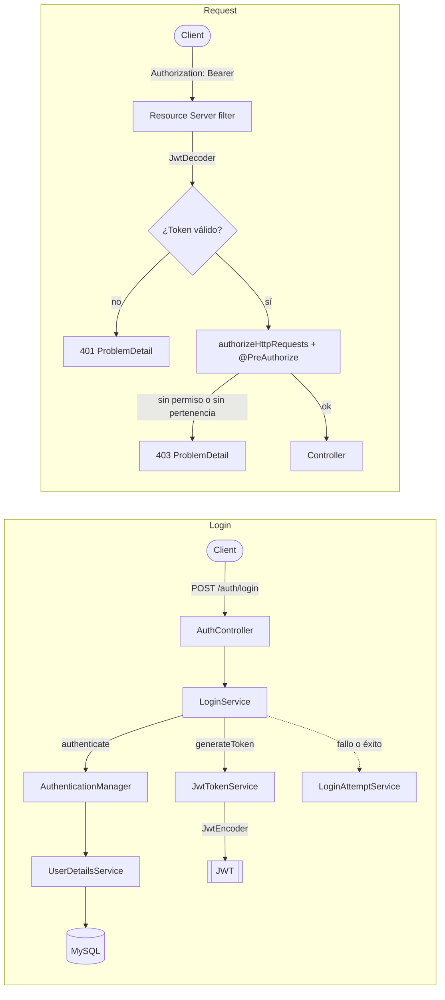

<div align="center">
  

  # CampusGate
</div>

API REST de una plataforma educativa (alumnos, profesores y cursos) construida para
**dominar Spring Security de punta a punta**: autenticación **stateless con JWT**, usuarios,
roles y permisos modelados desde cero, y autorización fina por permiso y por pertenencia.
Está hecha con las prácticas actuales (Spring Boot 4 y Spring Security 7) y no con el código
que trae el curso de TodoCode Academy, que sirvió como punto de partida y se reemplazó por
piezas declarativas del propio framework.


**🚀 API en vivo**: _(pendiente de deploy)_
_(si se despliega en un plan gratuito, la primera petición tras un rato sin tráfico puede tardar en responder mientras la instancia "despierta")_

**🖥️ Front**: _(pendiente)_

---

## Índice

- [Sobre el nombre](#sobre-el-nombre)
- [Objetivo](#objetivo)
- [Arquitectura de seguridad](#arquitectura-de-seguridad)
- [Decisiones de diseño](#decisiones-de-diseño)
- [Stack técnico](#stack-técnico)
- [Modelo de datos](#modelo-de-datos)
- [Roles y permisos](#roles-y-permisos)
- [Endpoints](#endpoints)
- [Modo demo](#modo-demo)
- [Estructura del repositorio](#estructura-del-repositorio)
- [Cómo correrlo en local](#cómo-correrlo-en-local)
- [Perfiles y configuración](#perfiles-y-configuración)
- [Proyecto relacionado](#proyecto-relacionado)
- [Roadmap](#roadmap)
- [Autor](#autor)

---

## Sobre el nombre

**Campus** + **Gate**: el dominio (una plataforma educativa) y el control de acceso (la
puerta que decide quién entra y qué puede hacer). El escudo del logo lleva un libro abierto
con una cerradura: educación protegida.

## Objetivo

Es el banco de pruebas de seguridad de mi roadmap. La idea es construir una vez, con
criterio y documentando cada decisión, todo lo que una API real necesita para autenticar y
autorizar, y después trasladar ese conocimiento a mis otros proyectos
([NodoBank](https://github.com/mdev-repos/microservicios_nodobank__proyecto_demostracion) y
los que vengan).

El dominio educativo se eligió porque permite practicar los dos niveles de autorización que
aparecen en el trabajo real:

- **Por permiso (RBAC)**: qué puede hacer cada tipo de usuario (administrador, profesor,
  alumno) sobre cada recurso.
- **Por pertenencia**: una regla que el permiso solo no resuelve, como "un profesor edita
  únicamente *sus* cursos" o "un alumno lee únicamente *su* perfil".

## Arquitectura de seguridad

Dos recorridos distintos: obtener un token (login) y usarlo en cada request.



Versión en texto plano:

```
LOGIN
POST /auth/login → AuthController → LoginService
                     ├─ AuthenticationManager (usuario, flags de cuenta y contraseña)
                     ├─ LoginAttemptService (cuenta fallos; bloqueo temporal)
                     └─ JwtTokenService → JwtEncoder → JWT firmado
                   ← { accessToken, tokenType, expiresIn }

CADA REQUEST
Authorization: Bearer <JWT> → filtro del Resource Server → JwtDecoder
     ├─ token inválido o vencido → 401 (ProblemDetail)
     ├─ @PreAuthorize: sin el permiso o sin ser dueño del recurso → 403 (ProblemDetail)
     └─ ok → Controller → Service → Repository
```

El emisor y el validador se apoyan en **Nimbus** a través de las interfaces `JwtEncoder` y
`JwtDecoder` de Spring Security: no hay filtro de validación escrito a mano.

Los controllers delegan en services y nunca devuelven entidades: toda respuesta es un DTO
(`record`) y todo error pasa por un `GlobalExceptionHandler` que lo traduce a `ProblemDetail`.

## Decisiones de diseño

| Tema | Decisión | Por qué |
|---|---|---|
| Roles y permisos | **Enums**: cada rol declara su conjunto de permisos | Pocos roles estables; la verdad vive en el código, versionada y sin desincronizarse de la BD |
| Qué se consulta | Las anotaciones piden **permisos** (`hasAuthority`), no roles | Los roles agrupan; si cambia lo que puede hacer un rol, se toca un solo lugar |
| Roles por usuario | `Set<Role>` | Una persona puede ser profesora y alumna a la vez; las authorities son la unión de los permisos |
| Cuenta y perfil | `UserSec` (seguridad) separado de `Student` y `Professor` (dominio), con la flecha del perfil hacia la cuenta | La seguridad no depende del dominio; un usuario puede tener ambos perfiles |
| Coherencia rol/perfil | Solo quien tiene el rol `PROFESSOR` puede tener perfil de profesor (ídem alumno), y no se puede quitar el rol mientras exista el perfil | Evita estados imposibles que volverían poco confiables las reglas de pertenencia |
| Pertenencia | `@PreAuthorize` con un bean propio (`@courseAuth.isOwner(...)`), más permisos `*_ANY` para el administrador | La política de acceso vive en un solo lugar; el permiso dice *qué*, el bean dice *sobre qué recurso* |
| Identificador de login | Email normalizado (minúsculas, sin espacios), único | Compatible con el login social que se suma después |
| `sub` del token | UUID del usuario, no el email | Es estable: el email puede cambiar |
| Contenido del token | `iss`, `sub`, `iat`, `exp`, `jti` y la lista de `permissions` | Mínima información: el payload lo puede leer cualquiera |
| Autorización HTTP | **Deny by default** (solo `/auth/login` es público) | Un endpoint nuevo nunca queda abierto por olvido |
| Sesión y CSRF | Stateless, sin cookie de sesión; CSRF desactivado con justificación | El token viaja en un header que el navegador no envía solo |
| Errores | 401, 403 y el resto en JSON (`ProblemDetail`), con mensajes genéricos | No se revela si un usuario existe, está deshabilitado o bloqueado |
| Fuerza bruta | Bloqueo temporal tras N fallos de contraseña (configurable) | Limita el adivinado de contraseñas; el cambio de contraseña también cuenta los fallos |
| Bajas | Baja lógica: `DELETE /users/{id}` deshabilita, no borra | Se conserva la auditoría y la integridad con perfiles y cursos |
| Listados | Paginación con tope de tamaño y lista blanca de campos de orden | Evita pedidos gigantes y que el orden revele datos sensibles (por ejemplo el hash) |
| Orden de revisiones | Primero la cadena de filtros (token), después la validación del cuerpo y recién después `@PreAuthorize` | Es el orden real de Spring MVC: una cuenta sin permiso que envía un cuerpo inválido recibe 400; con cuerpo válido recibe 403 |
| Mass assignment | Los DTO de entrada no incluyen flags de cuenta ni identificadores sensibles | El cliente no decide `enabled`, ni sobre qué usuario opera |
| Secretos | Solo por variable de entorno, con validación *fail fast* | La app se niega a arrancar si falta o es débil una configuración |
| Primer administrador | *Seed* idempotente al arrancar | Se crea una sola vez y nunca se pisa; sin esto no habría quién cree usuarios |
| Contraseñas | `DelegatingPasswordEncoder` (BCrypt con prefijo), máximo 72 caracteres | Permite migrar de algoritmo; BCrypt solo usa los primeros 72 bytes |

## Stack técnico

| Categoría | Tecnología |
|---|---|
| Lenguaje | Java 25 |
| Framework | Spring Boot 4 + Spring Security 7 |
| Tokens | JWT firmado (HS256), emitido y validado con Nimbus a través de Spring Security |
| Autorización | `@PreAuthorize` + `hasAuthority` + SpEL con beans propios (method security) |
| Base de datos | MySQL 8 (desarrollo) · PostgreSQL (demo desplegada, en Neon) |
| ORM | Hibernate 7 + Spring Data JPA |
| Validación | Jakarta Bean Validation, también para la configuración (`@ConfigurationProperties` validado) |
| Manejo de errores | `ProblemDetail` (RFC 9457) + `@RestControllerAdvice` centralizado |
| Build | Maven |
| Reducción de boilerplate | Lombok |

## Modelo de datos

| Entidad | Campos principales | Relaciones |
|---|---|---|
| `UserSec` | `id` (UUID), `email` (único), `passwordHash`, `enabled`, `accountNotLocked`, `failedLoginAttempts`, `lockedUntil`, `roles`, `createdAt`, `updatedAt` | — |
| `Professor` | `id` (UUID), `firstName`, `lastName` | `@OneToOne` con `UserSec` (único) |
| `Student` | `id` (UUID), `firstName`, `lastName` | `@OneToOne` con `UserSec` (único) |
| `Course` | `id` (UUID), `title`, `description` | `@ManyToOne` con `Professor` (el dueño) · `@ManyToMany` con `Student` |

## Roles y permisos

| Rol | Permisos |
|---|---|
| `ADMIN` | Todos, incluidos los `*_ANY` (`COURSE_UPDATE_ANY`, `STUDENT_READ_ANY`, `PROFESSOR_READ_ANY`: actuar sobre cualquier recurso) |
| `PROFESSOR` | `COURSE_READ`, `COURSE_UPDATE` (solo sobre sus cursos), `STUDENT_READ`, `PROFESSOR_READ` |
| `STUDENT` | `COURSE_READ`, `STUDENT_READ` (solo sobre su propio perfil) |

## Endpoints

Todos exigen un token válido salvo `POST /auth/login`. La columna **Acceso** indica el permiso
requerido; "+ dueño" significa que además el recurso debe pertenecerle al usuario.

**Autenticación** — base path `/auth`

| Método | Ruta | Descripción | Acceso | Éxito | Errores |
|---|---|---|---|---|---|
| `POST` | `/login` | Devuelve un JWT | público | `200 OK` | `400`, `401` |
| `GET` | `/me` | Id y permisos del token actual | autenticado | `200 OK` | `401` |
| `PUT` | `/password` | Cambia la contraseña propia | autenticado | `204 No Content` | `400`, `401`, `409` |

**Estado** — base path `/ping` (públicos, para precalentar la instancia)

| Método | Ruta | Descripción | Éxito |
|---|---|---|---|
| `GET` | `` | Responde sin tocar la base (sirve para un pinger externo) | `200 OK` |
| `GET` | `/ready` | Ejecuta un `SELECT 1`: confirma que la base también despertó | `200 OK` / `503` |

**Usuarios** — base path `/users`

| Método | Ruta | Descripción | Acceso | Éxito | Errores |
|---|---|---|---|---|---|
| `POST` | `` | Crea un usuario | `USER_CREATE` | `201 Created` | `400`, `403`, `409` |
| `GET` | `/{id}` | Obtiene un usuario | `USER_READ` | `200 OK` | `400`, `403`, `404` |
| `GET` | `` | Lista paginada (`page`, `size`, `sort`) | `USER_READ` | `200 OK` | `400`, `403` |
| `PATCH` | `/{id}` | Cambia roles, habilitado o bloqueo | `USER_UPDATE` | `200 OK` | `400`, `403`, `404`, `409` |
| `DELETE` | `/{id}` | Deshabilita al usuario (baja lógica) | `USER_DELETE` | `204 No Content` | `403`, `404`, `409` |

**Profesores** — base path `/professors`

| Método | Ruta | Descripción | Acceso | Éxito | Errores |
|---|---|---|---|---|---|
| `POST` | `` | Crea el perfil de profesor de un usuario | `PROFESSOR_CREATE` | `201 Created` | `400`, `403`, `404`, `409` |
| `GET` | `/{id}` | Obtiene un perfil | `PROFESSOR_READ` | `200 OK` | `403`, `404` |
| `GET` | `` | Lista paginada de profesores | `PROFESSOR_READ_ANY` | `200 OK` | `400`, `403` |
| `GET` | `/me` | Perfil del profesor autenticado | `PROFESSOR_READ` | `200 OK` | `403`, `404` |
| `GET` | `/me/courses` | Cursos que dicta el profesor autenticado | `PROFESSOR_READ` | `200 OK` | `403` |

**Alumnos** — base path `/students`

| Método | Ruta | Descripción | Acceso | Éxito | Errores |
|---|---|---|---|---|---|
| `POST` | `` | Crea el perfil de alumno de un usuario | `STUDENT_CREATE` | `201 Created` | `400`, `403`, `404`, `409` |
| `GET` | `/{id}` | Obtiene un perfil | `STUDENT_READ_ANY`, o `STUDENT_READ` + dueño | `200 OK` | `403`, `404` |
| `GET` | `` | Lista paginada de alumnos | `STUDENT_READ_ANY` | `200 OK` | `400`, `403` |
| `GET` | `/me` | Perfil del alumno autenticado | `STUDENT_READ` | `200 OK` | `403`, `404` |
| `GET` | `/me/courses` | Cursos en los que está matriculado | `STUDENT_READ` | `200 OK` | `403` |

**Cursos** — base path `/courses`

| Método | Ruta | Descripción | Acceso | Éxito | Errores |
|---|---|---|---|---|---|
| `POST` | `` | Crea un curso y le asigna un profesor | `COURSE_CREATE` | `201 Created` | `400`, `403`, `404` |
| `GET` | `/{id}` | Obtiene un curso | `COURSE_READ` | `200 OK` | `403`, `404` |
| `GET` | `` | Lista paginada (`page`, `size`, `sort`) | `COURSE_READ` | `200 OK` | `400`, `403` |
| `PUT` | `/{id}` | Edita título y descripción | `COURSE_UPDATE_ANY`, o `COURSE_UPDATE` + dueño | `200 OK` | `400`, `403`, `404` |
| `DELETE` | `/{id}` | Elimina un curso | `COURSE_DELETE` | `204 No Content` | `403`, `404` |
| `GET` | `/{id}/students` | Alumnos matriculados (paginado) | `COURSE_UPDATE_ANY`, o `COURSE_UPDATE` + dueño | `200 OK` | `400`, `403`, `404` |
| `POST` | `/{courseId}/students/{studentId}` | Matricula a un alumno | `COURSE_UPDATE_ANY` | `204 No Content` | `403`, `404`, `409` |
| `DELETE` | `/{courseId}/students/{studentId}` | Desmatricula a un alumno | `COURSE_UPDATE_ANY` | `204 No Content` | `403`, `404` |

<details>
<summary><strong>Ejemplo — login</strong></summary>

`POST /auth/login`

```json
{ "email": "admin@ejemplo.com", "password": "la_contraseña_inicial" }
```

`200 OK`

```json
{ "accessToken": "eyJhbGciOi...", "tokenType": "Bearer", "expiresIn": 1800 }
```

El token se envía en cada request como `Authorization: Bearer <accessToken>`.

</details>

<details>
<summary><strong>Ejemplo — error de validación</strong></summary>

`POST /users` con un cuerpo inválido

`400 Bad Request`

```json
{
  "title": "Bad Request",
  "status": 400,
  "detail": "Validation failed",
  "instance": "/users",
  "errors": {
    "email": "must be a well-formed email address",
    "password": "size must be between 12 and 72"
  }
}
```

La respuesta nunca incluye el valor rechazado (podría ser una contraseña).

</details>

<details>
<summary><strong>Ejemplo — pertenencia: un profesor edita un curso ajeno</strong></summary>

`PUT /courses/{id}` con el token de otro profesor

`403 Forbidden`

```json
{ "title": "Forbidden", "status": 403, "detail": "Access denied", "instance": "/courses/..." }
```

Si el curso no existe, un profesor recibe el mismo `403`: no puede averiguar qué ids existen.

</details>

<details>
<summary><strong>Ejemplo — login fallido</strong></summary>

Contraseña incorrecta, email inexistente y cuenta bloqueada devuelven **la misma** respuesta.
El detalle solo queda en el log interno.

`401 Unauthorized`

```json
{ "title": "Unauthorized", "status": 401, "detail": "Invalid credentials", "instance": "/auth/login" }
```

</details>

## Modo demo

Con `SPRING_PROFILES_ACTIVE=demo` la API sirve para una demostración pública con datos ficticios
(8 profesores, 40 alumnos y 12 cursos con matrículas) y tres cuentas de ejemplo, todas con la
contraseña definida en `DEMO_PASSWORD`:

| Cuenta | Rol |
|---|---|
| `admin@campusgate.demo` | Administrador |
| `profesor@campusgate.demo` | Profesor (dicta 3 cursos) |
| `alumno@campusgate.demo` | Alumno (matriculado en 4 cursos) |

Como las credenciales son públicas, el modo demo toma precauciones:

- Las cuentas `@campusgate.demo` **no pueden** cambiar su contraseña, deshabilitarse ni cambiar de roles,
  y **no se bloquean** por intentos fallidos.
- Al arrancar, y todos los días a las 4:00 (hora de Buenos Aires), se **borran todos los usuarios y datos
  menos el administrador real** y se vuelve a cargar el conjunto de datos de demostración. Lo que cree
  cualquier visitante desaparece solo.
- El administrador real (`ADMIN_EMAIL`) vive aparte, con un secreto que nunca se publica.

> ⚠️ Nunca activar este perfil contra una base con datos reales: el reseteo borra todo.

Con el perfil por defecto (`dev`) **no se cargan datos de demostración**: solo se crea el administrador real.
Para correr la demo en local:

```bash
cd campusgate
export JWT_SECRET='...' ADMIN_EMAIL='admin@ejemplo.com' ADMIN_PASSWORD='...'
export SPRING_PROFILES_ACTIVE=demo DEMO_PASSWORD='al-menos-12-caracteres'
./mvnw spring-boot:run
```

En el log de arranque aparece `Demo data reset` cuando los datos se cargaron. Si `DEMO_PASSWORD` falta o es
corta, la aplicación no arranca.

## Estructura del repositorio

Monorepo con el proyecto Maven en `campusgate/`.

```
security_campusgate__proyecto_demostracion/
├── assets/
├── campusgate/
│   ├── Dockerfile
│   └── src/main/java/com/mdev/campusgate
│       ├── configuration/   # SecurityConfig, JwtConfig, propiedades validadas, seed del admin
│       ├── security/        # UserDetailsService, emisor de tokens, handlers 401/403, reglas de pertenencia
│       ├── controller/      # Auth, User, Professor, Student, Course
│       ├── dto/             # request/ y response/
│       ├── exception/       # excepciones de negocio + GlobalExceptionHandler
│       ├── mapper/          # Entity → DTO
│       ├── model/           # UserSec, Professor, Student, Course + enums (Role, Permission)
│       ├── repository/
│       ├── service/         # interfaces + impl/
│       └── utils/           # normalizador de email, validador de paginación
└── README.md
```

## Cómo correrlo en local

**Prerrequisitos**: JDK 25 y un MySQL en `localhost:3306` con una base `campus_gate_db`.

```bash
mysql -u root -p -e "CREATE DATABASE campus_gate_db;"
```

La aplicación **no arranca si falta alguna** de estas variables de entorno (a propósito):

| Variable | Descripción |
|---|---|
| `JWT_SECRET` | Secreto de firma del JWT, de al menos 32 caracteres |
| `ADMIN_EMAIL` | Email del primer administrador |
| `ADMIN_PASSWORD` | Contraseña inicial del administrador, de al menos 12 caracteres |

Opcionales, con valor de desarrollo por defecto:

| Variable | Descripción |
|---|---|
| `DB_URL`, `DB_USERNAME`, `DB_PASSWORD` | Conexión a la base (por defecto, MySQL local) |
| `CORS_ALLOWED_ORIGINS` | Orígenes del navegador que pueden llamar a la API, separados por coma (por defecto: Vite local y GitHub Pages) |
| `PORT` | Puerto de la API (por defecto `8080`; las plataformas como Render lo inyectan) |
| `DEMO_PASSWORD` | Solo para el modo demo: contraseña pública de las cuentas de demostración (mínimo 12 caracteres) |

También se puede construir y correr con Docker:

```bash
cd campusgate
docker build -t campusgate .
docker run -p 8080:8080 -e JWT_SECRET='...' -e ADMIN_EMAIL='...' -e ADMIN_PASSWORD='...' \
  -e DB_URL='jdbc:mysql://host.docker.internal:3306/campus_gate_db?useSSL=false&allowPublicKeyRetrieval=true' \
  -e DB_USERNAME=root -e DB_PASSWORD='...' campusgate
```

Un secreto razonable se genera localmente (nunca en una página web, ni se versiona):

```bash
openssl rand -base64 48
```

Levantarla:

```bash
cd campusgate
export JWT_SECRET='...' ADMIN_EMAIL='admin@ejemplo.com' ADMIN_PASSWORD='...'
./mvnw spring-boot:run
```

La API queda en `http://localhost:8080`. Para obtener un token con el administrador creado
por el *seed*:

```bash
curl -X POST http://localhost:8080/auth/login \
  -H "Content-Type: application/json" \
  -d '{"email":"admin@ejemplo.com","password":"la_contraseña_inicial"}'
```

## Perfiles y configuración

`application.properties` no contiene secretos: cada valor sensible se lee de una variable de
entorno. Hay dos perfiles de Spring, sin cambios de código entre uno y otro:

| Perfil | Uso | `ddl-auto` | Logs |
|---|---|---|---|
| `dev` (default) | Desarrollo local | `update` | `DEBUG` en la aplicación, Security y SQL |
| `prod` | Despliegue con el esquema ya creado (`SPRING_PROFILES_ACTIVE=prod`) | `validate` | `INFO` / `WARN` |
| `demo` | Demo pública con datos ficticios (`SPRING_PROFILES_ACTIVE=demo`) | `update` | `INFO` / `WARN` |

El `DEBUG` de Spring Security imprime emails y stack traces, por eso nunca se usa fuera de
desarrollo. En `prod` el esquema ya debe existir: sin una herramienta de migraciones, la
aplicación solo valida que coincida con las entidades.

El motor se detecta solo a partir de la URL de conexión: el mismo código corre sobre MySQL y
PostgreSQL (ambos drivers están en el `pom.xml`). Con Neon la URL necesita `?sslmode=require`.

### Despliegue (Render + Neon)

La demo pública corre como un servicio **Docker** de [Render](https://render.com) (plan gratuito, directorio raíz
`campusgate`, health check en `/ping`) con la base en [Neon](https://neon.tech) (PostgreSQL serverless). Variables
de entorno del servicio:

| Variable | Valor |
|---|---|
| `SPRING_PROFILES_ACTIVE` | `demo` |
| `DB_URL` | `jdbc:postgresql://<host>.neon.tech/<base>?sslmode=require` (Neon exige SSL) |
| `DB_USERNAME`, `DB_PASSWORD` | Credenciales de la base, por separado de la URL |
| `JWT_SECRET` | Secreto de firma (`openssl rand -base64 48`) |
| `ADMIN_EMAIL`, `ADMIN_PASSWORD` | Administrador real (nunca se publica) |
| `DEMO_PASSWORD` | Contraseña pública de las cuentas de ejemplo; debe coincidir con `VITE_DEMO_PASSWORD` del front |
| `CORS_ALLOWED_ORIGINS` | Origen del front, por ejemplo `https://mdev-repos.github.io` (sin ruta ni barra final) |

Render inyecta `PORT` y la aplicación lo usa. Con el plan gratuito la instancia se duerme tras un rato sin
tráfico: el front dispara `GET /ping/ready` al abrirse para despertarla (y a la base) mientras la persona lee la
landing.

Otras propiedades:

| Propiedad | Valor por defecto | Descripción |
|---|---|---|
| `app.security.jwt.expiration-seconds` | `1800` | Vida del token (30 minutos) |
| `app.security.login.max-failed-attempts` | `5` | Fallos de contraseña antes del bloqueo temporal |
| `app.security.login.lock-minutes` | `15` | Duración del bloqueo |
| `spring.data.web.pageable.default-page-size` | `20` | Tamaño de página por defecto |
| `spring.data.web.pageable.max-page-size` | `50` | Tamaño máximo que puede pedir el cliente |

## Proyecto relacionado

Front que consume esta API:
[`front_campusgate__proyecto_demostracion`](https://github.com/mdev-repos/front_campusgate__proyecto_demostracion)
(React + TypeScript). Tiene una landing, un semáforo que informa si la API ya despertó, tres cuentas de ejemplo,
las vistas de administrador, profesor y alumno, un inspector del JWT y un laboratorio que dispara requests
prohibidos a propósito para ver los 401, 403 y 400 reales.

## Roadmap

**Backend**
- [x] Modelo de seguridad: permisos, roles y usuario con flags de cuenta
- [x] `UserDetailsService` con authorities derivadas de los permisos
- [x] Configuración del JWT validada con *fail fast*, y secretos por variable de entorno
- [x] Emisión y validación de tokens (Nimbus) con resource server nativo
- [x] `SecurityFilterChain` stateless con *deny by default*
- [x] Respuestas 401 y 403 en formato `ProblemDetail`
- [x] Login con `AuthenticationManager` y primer administrador por *seed*
- [x] `GlobalExceptionHandler` con errores genéricos y validación por campo
- [x] Bloqueo temporal por intentos fallidos
- [x] CRUD de usuarios protegido por permisos (con baja lógica y paginación)
- [x] Cambio de contraseña propia
- [x] Profesores, alumnos y cursos, con reglas de pertenencia
- [x] Perfiles `dev`, `prod` y `demo`
- [x] Endpoints de consumo para un front: perfil propio, cursos propios, listados y roster
- [x] CORS por ambiente y `/ping` para precalentar la instancia
- [x] Compatibilidad con PostgreSQL y Dockerfile
- [x] Modo demo con datos ficticios y reseteo automático

**Pendiente**
- [ ] Front de consumo
- [ ] Deploy (Render + Neon)
- [ ] Colección de Postman con casos positivos y negativos
- [ ] Tests unitarios y de integración

**Limitaciones conocidas y dónde se resuelven**

Son temas con entidad propia, y se van a trabajar en
[NodoBank](https://github.com/mdev-repos/microservicios_nodobank__proyecto_demostracion):

| Pendiente | Qué es realmente |
|---|---|
| RS256 + JWKS | Un concepto nuevo (claves asimétricas), no un retoque |
| Refresh tokens y revocación | Resuelve que el JWT siga vivo tras deshabilitar o cambiar la contraseña |
| Login social | `oauth2-client`, otra pieza entera |
| Rate limiting, Flyway, N+1 | Endurecimiento de producción |

## Autor

**Matías Mazzitelli**
_Backend Developer — Java / Spring Boot_

[GitHub] https://github.com/mdev-repos · [LinkedIn] https://www.linkedin.com/in/mnm-dev
